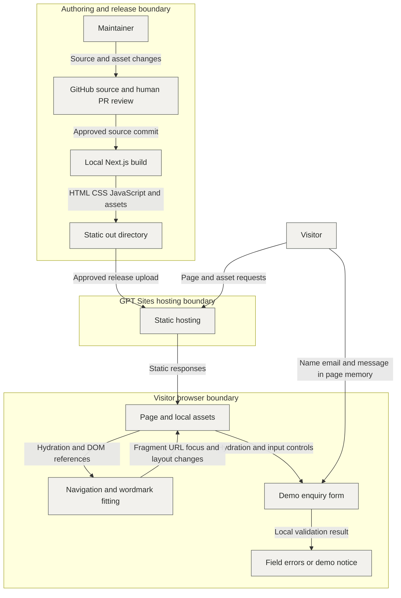

# KILN architecture

Status: documentation draft for review, 21 October 2026. Implementation evidence: Git commit `a597eba0374d7422436165928e74c562e1be06a4` on `origin/main`. Existing constraints below come from the project brief and repository configuration; this document does not approve new architectural decisions or certify the hosted deployment.

## Purpose and sources of truth

KILN is a single English-language portfolio page for a fictional residential architecture studio. The intended architecture is the existing static site: content and assets are versioned, while browser JavaScript provides navigation, wordmark fitting and a local demonstration form.

[brief.md](brief.md) owns product requirements. [DESIGN.md](DESIGN.md), including its later revisions, owns visual decisions. [AGENTS.md](AGENTS.md) owns contribution and review rules. [README.md](README.md) owns setup instructions and commands. Source in GitHub is authoritative for code; GPT Sites hosts a built release. The implementation plan and historical stage reports are local working materials, not prerequisites for building a fresh checkout.

## Boundary and data flow

The host serves files; it receives no enquiry submission from the application. Input values remain in browser controls and temporary validation variables. The release path and visitor path are separate: GitHub and ImageGen are not runtime dependencies. No application database or persistent visitor data store exists.

## Responsibilities and dependencies

| Owner | Responsibility and contract |
| --- | --- |
| [app/layout.tsx](app/layout.tsx) | English document, metadata, shared styles and font preloads. |
| [app/page.tsx](app/page.tsx) | Static section composition, typed project/service/process content, stable section anchors and CTA links. |
| [components/ConceptImage.tsx](components/ConceptImage.tsx) | Typed image slots, responsive WebP/JPEG source sets, explicit dimensions, eager hero and lazy project loading. |
| [components/Navigation.tsx](components/Navigation.tsx) | Client Component owning menu state, breakpoint changes, focus restoration, Escape/outside closure and same-page navigation. |
| [components/EnquiryForm.tsx](components/EnquiryForm.tsx) | Client Component owning validation errors and completion notice. No transport or persistence adapter. |
| [components/FittedWordmark.tsx](components/FittedWordmark.tsx) | Client Component measuring the KILN mark after layout/font changes; cleans up observer and font listener. |
| [components/OutlineIcon.tsx](components/OutlineIcon.tsx) | Authored decorative SVGs; meaning remains in adjacent text. |
| [app/globals.css](app/globals.css) and CSS Modules | Shared tokens/font declarations and locally scoped presentation. Components consume the design system. |
| public/assets and public/fonts | Runtime assets served from the same site; originals and generation tools are outside the runtime. |
| [next.config.ts](next.config.ts) and [.openai/hosting.json](.openai/hosting.json) | Static export and hosting directory contract. |

The page imports components; components do not import the page. Static content stays in source rather than a CMS or browser fetch. Browser-only APIs belong in Client Component lifecycle/event logic. Build-time rendering does not imply a production Next.js server.

## Data model and lifecycle

| Model | Identity and ownership | Lifecycle and constraints |
| --- | --- | --- |
| ConceptProject | Page-owned array; current React key is its unique name; image uses ImageSlot. | Three versioned concepts with setting, description, alt text and responsive sizes. Changes require source review and rebuild. No runtime CRUD. |
| Service / process stage | Page-owned arrays; current keys are unique names; icons use IconName. | Three services and four ordered stages. Shared shape does not imply shared mutable state. |
| ImageSlot | `hero`, `courtyard`, `ridge`, `woodland`; owned by ConceptImage. | Four images, each with 480/768/1280/1536 width variants in WebP and JPEG. The component supplies a 1536 by 1024 intrinsic frame. |
| EnquiryValues | `name`, `email`, `message`; no record identifier. | Values live in uncontrolled DOM fields and a temporary object during submission. Required values are checked with trimming; email uses a local format check. No durable enquiry entity exists. |
| EnquiryErrors | Partial mapping from field name to message. | React state; updated after submission and while correcting a field with an error. |
| Completion flag | Form-local boolean. | True after valid submission and field reset; cleared on edits. It means validation completed, never delivery. |
| Navigation state | Component-local open flag, pending fragment and element refs. | Reset on closure/breakpoint changes. Only section fragments enter browser history; form values never do. |

No transaction, cross-client consistency, retention service or schema migration is needed. Browser memory is transient; the application makes no promise to erase browser-managed history or memory beyond its own controls. `autoComplete="off"` is a hint to the browser, not a security boundary.

## Runtime flows and failure behavior

1. A browser requests `/`. Static HTML supplies the content; CSS, fonts, images and JavaScript load from the same host. React hydrates the three Client Component types. JavaScript is required for menu, fitting and validation behavior; a JavaScript-disabled enquiry fallback is not implemented.
2. Under 900px, closed drawer content is inert. A normal menu link closes the drawer, waits for actual closing animations, updates the fragment, focuses the target without automatic scrolling, then scrolls to it. Reduced motion skips smooth scrolling. Desktop and modified clicks retain native anchor behavior. Escape and outside clicks close the drawer; breakpoint changes repair focus.
3. Form submission prevents native submission and validates all fields. Invalid input renders field-linked errors, then focuses the first invalid field and positions its label/control/error wrapper together. Correcting an errored field revalidates that field.
4. Valid submission resets the controls and displays exactly **“Demo only — your enquiry has not been sent or saved.”** No request, retry queue, email, storage write or delivery status follows. Reloading creates a new component state.
5. Wordmark fitting measures available width and natural letter width, shrinks only when necessary, and repeats after resize/font loading. Ordinary content retains normal text reflow.

Missing image/font responses are static resource failures, not application retries. Images retain descriptive alt text; missing local fonts fall back, which does not establish visual acceptance. Fix the source or local release inputs, run the checks and publish an approved replacement.

## Architectural invariants

These are existing project constraints, with intended enforcement and proof. The evidence column names checks to run when relevant; it does not report a fresh successful run.

| ID | Rule | Enforcement and proof |
| --- | --- | --- |
| INV-1 | One static page, no backend, database, accounts, CMS, Server Actions or runtime Next.js routes. | Review source and `output: 'export'`; production build must emit out/index.html and work through a static server. |
| INV-2 | Enquiry input never leaves page memory through application code and is never persisted. | Review submit handler and dependencies; inspect network and browser storage for empty, invalid and valid submissions. |
| INV-3 | CTA and valid demo notice retain their exact agreed English text. | Review page/form output against brief.md; exercise valid submission. |
| INV-4 | Images are preoptimized local files; no runtime image optimizer. | Review ConceptImage source sets; inspect all four images in the static export at 375, 768 and 1440px. |
| INV-5 | TypeScript strict, typed module boundaries, CSS Modules and shared visual tokens remain in use. | Review tsconfig.json and changes; run typecheck and lint. Do not hide errors with any or unchecked assertions. |
| INV-6 | Interaction remains keyboard accessible and respects reduced motion. | Exercise menu closure/focus, responsive transitions, field errors and valid completion; inspect reduced-motion behavior. |
| INV-7 | GitHub approval precedes publication of changed site source. | Human PR merge; record the released main commit and returned deployment version/status. Sites synchronization must not replace the GitHub remote. |
| INV-8 | Runtime assets preserve provenance and redistribution boundaries. | Review README font setup, public/font notices and asset inventory. Do not commit local-only Fontshare files or credentials. |

## Build, hosting and recovery

The pinned toolchain and exact commands live in package.json, package-lock.json and README.md. Currently: Node 22.21.0, npm 10.9.4, Next.js 16.4.2, React 19.3.1 and TypeScript strict. These describe the checked source, not a recommendation to upgrade.

A release uses `npm ci`, `npm run typecheck`, `npm run lint`, and `npm run build`; `npm run preview` serves the resulting out directory on port 4173. Stop development before building. Keep dependencies and generated output local to the worktree. Inspect the actual static output before release; dev-server success is insufficient.

A fresh checkout must separately obtain Panchang Bold and Switzer Regular/Medium as described in README.md. Their files are ignored and not distributed in Git. Manrope and Bodoni Moda plus OFL notices are tracked; current headings use Manrope, while Panchang is the wordmark and Switzer the body family. A build without the missing fonts may succeed with fallback rendering or missing resource responses, so build success alone is insufficient release proof.

Hosting configuration identifies a GPT Sites project and serves `out`. README links a live demo; neither that link nor configuration proves which commit is currently hosted. Do not infer current sharing permissions from the URL. Project policy keeps hosting private unless the user separately authorizes public sharing; repository visibility and hosting access are independent settings requiring service evidence.

There is no application authorization layer, secret store, analytics integration or enquiry logging. Host access controls and infrastructure logs belong to the hosting provider; no unverified retention claim is made for them. Do not add visitor input to telemetry. HTML rendering uses React text content rather than an enquiry HTML injection path.

If release preparation fails, keep the existing deployment and fix the build inputs. If a released site regresses, prepare the last approved source commit with its required local fonts, verify the static output and deploy it through the authorized release workflow. No data migration is involved. Availability, CDN caching, deployment rollback features and recovery time are not specified by source; confirm provider behavior before relying on them.

## Status, tradeoffs and remaining proof

The static architecture, component boundaries, image variants, local validation, strict typing and hosting directory are implemented in the inspected commit. This document proposes no migration and does not change behavior. Documentation review does not require a deployment.

Static export keeps hosting simple and avoids handling personal enquiries, at the cost of requiring source edits/rebuilds and offering no actual contact delivery. A CMS or submission API would change ownership, trust and storage boundaries and requires a separate product decision. Native responsive images keep runtime hosting independent of a Next.js optimizer, at the cost of preparing and maintaining variants. Small Client Components supply necessary browser behavior while introducing a JavaScript dependency for interaction.

No supported traffic, latency, availability, recovery-time or hosting-cost targets are recorded. Do not invent them. The practical checks are asset completeness, stable image frames, no horizontal overflow, usable navigation/form, and no runtime console errors at the agreed widths. Image/font payloads and client hydration are the principal delivery costs; measure a production export before making quantitative claims.

Remaining release proof includes checking licensed local font inputs, running the configured code checks after code changes, testing network/storage behavior, accessibility and reduced motion against static output, and confirming hosted commit, deployment status and actual sharing permissions when publishing. Historical acceptance and current service status must not be inferred solely from this architecture draft.
