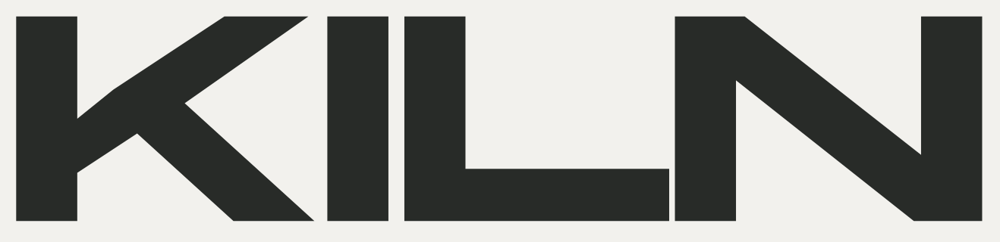

# KILN Luxury Architects



A residential architecture portfolio concept built with Next.js, React and TypeScript. KILN is a fictional studio, and the homes shown are demonstration concepts illustrated with AI-generated imagery.

[View the live demo](https://kiln-luxury-architects.stoyanov-dann.chatgpt.site)

## Features

- A single page with projects, studio, services, process and contact sections.
- Responsive architecture imagery in WebP and JPEG formats.
- An accessible navigation menu and keyboard focus states.
- Local fonts, CSS Modules and reduced-motion support.
- A demonstration enquiry form with required-field and email validation.

The form displays **“Demo only — your enquiry has not been sent or saved.”** after valid input. It does not send or store enquiries. There is no backend, database, CMS or account system.

## Technology

- Next.js 16.4.2 with the App Router and static export.
- React 19.3.1 and TypeScript in strict mode.
- CSS Modules and shared CSS custom properties.
- npm with a committed lockfile.

The production output is plain HTML, CSS, JavaScript and assets in `out/`. Hosting the built site does not require a Node.js or Next.js server.

## Getting started

Use **Node.js 22.21.0** and **npm 10.9.4**. The supported ranges are recorded in `package.json`; `.nvmrc` pins Node.js.

```sh
npm ci
npm run dev
```

Open [localhost:3000](http://localhost:3000). To choose another port, run `npm run dev -- --port 3001`.

## Commands

| Command | Purpose |
| --- | --- |
| `npm run dev` | Start the local development server. |
| `npm run typecheck` | Generate Next.js types and check TypeScript. |
| `npm run lint` | Run ESLint without allowing warnings. |
| `npm run build` | Create the production static export in `out/`. |
| `npm run preview` | Serve the existing `out/` directory on port 4173. |

Stop the development server before building. To build and view the static site:

```sh
npm run build
npm run preview
```

Open [localhost:4173](http://localhost:4173). Generated output and dependencies are not committed. Building the site does not require Python, image generation or the local development archives.

## Project structure

```text
app/             Page, layout, global styles and metadata
components/      Sections, imagery, navigation and demo form
public/assets/   Optimized architecture images
public/fonts/    Self-hosted fonts and their licenses
scripts/         Pinned design-tool source verification
.openai/         Static hosting configuration for GPT Sites
```

- [Project brief](brief.md) describes the audience, content and demo constraints.
- [Design notes](DESIGN.md) record the visual system and its revisions.
- [Contribution and agent instructions](AGENTS.md) describe the repository workflow.
- [Design tooling](docs/taste-skill.md) records the pinned Taste Skill source and usage.

Implementation plans, stage reports, screenshots, image-generation originals and stage QA helpers are local working materials excluded from the tracked source.

## Assets and attribution

The four architectural images were created with ImageGen for this fictional project. Their optimized variants are included in `public/assets/`; they do not represent completed commissions or real clients.

Manrope, Panchang and Switzer are served locally. Font licenses are included in [public/fonts](public/fonts/). The pinned third-party Taste Skill retains its [MIT license](.agents/skills/design-taste-frontend/LICENSE) and [source manifest](taste-skill-source.json).

## Hosting

The live demo is hosted on GPT Sites. `.openai/hosting.json` declares `out` as the static directory. GitHub is the source and review location; documentation changes do not require a website deployment.
