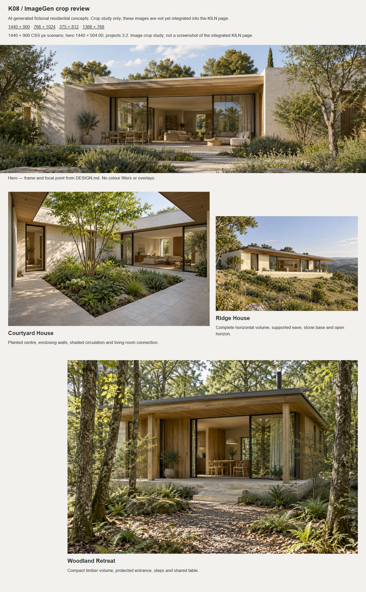
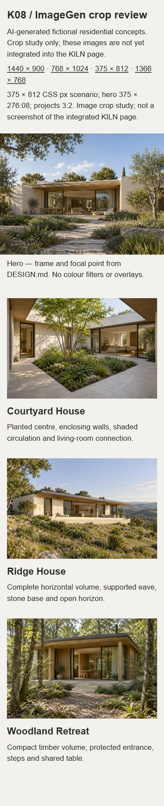

# K08 / SIN-39 — ImageGen originals

20 октомври 2026 г. · [Linear SIN-39](https://linear.app/singularity-lab/issue/SIN-39/k08-generirane-s-imagegen)

Четири оригинални архитектурни концепции от вградения `image_gen.imagegen`, създадени лично от агента по [DESIGN.md, раздел 7](../../DESIGN.md#7-архитектурни-изображения--договор-за-k08k09). Един общ фотографски характер: минерални стени, естествено дърво, тънки тъмни рамки, странична дневна светлина и умерен климат. Това са AI-generated fictional concepts, а не фотографии на изпълнени KILN поръчки.

Предходният [K07 PR #8](https://github.com/danstoyanov/kiln-luxury-architects/pull/8) е MERGED на 20 октомври 2026 г., 13:21:56 UTC. Remote refs са обновени; база на отделното управлявано worktree и клона `codex/sin-39-imagegen`: `2b4a2784738680d2f1127e2791bbfce956943096`.

## Оригинали и точни промптове

| Slot | Непроменен оригинал | Точен подаден prompt | Размер | PNG bytes |
| --- | --- | --- | --- | --- |
| Hero | [hero.png](originals/hero.png) | [hero.txt](prompts/hero.txt) | 1536×1024, RGB, 3:2 | 3,468,053 |
| Courtyard House | [courtyard.png](originals/courtyard.png) | [courtyard.txt](prompts/courtyard.txt) | 1536×1024, RGB, 3:2 | 3,349,886 |
| Ridge House | [ridge.png](originals/ridge.png) | [ridge.txt](prompts/ridge.txt) | 1536×1024, RGB, 3:2 | 3,258,046 |
| Woodland Retreat | [woodland.png](originals/woodland.png) | [woodland.txt](prompts/woodland.txt) | 1536×1024, RGB, 3:2 | 3,818,795 |

Всеки TXT съдържа целия точен prompt, включително общата фотографска дисциплина и специфичната сцена; няма отделен скрит negative prompt. Четири отделни извиквания, по едно за slot; първият резултат за всеки е избран след преглед. Няма входни/референтни изображения, stock изображения, imitation prompt, CLI/API fallback или последваща обработка. Единственият допълнителен подаден параметър е `transparent_background: false`. Инструментът не върна име на модел или seed; такива не се приписват.

[manifest.json](manifest.json) записва инструмента, датата, имената на върнатите PNG файлове, измерените размери/bytes и SHA-256 за всеки оригинал и prompt. PNG файловете са byte-for-byte копия от изхода на инструмента, включително оригиналната metadata. Pillow decode/verify, проверката за точно 3:2 и сравняването с изходните SHA-256 минават. Промптовете документират намерението, но не гарантират възпроизвеждане на същите пиксели при ново генериране.

## Визуален подбор

Прегледани са целите masters на native 1536×1024 и браузърните crop кадри. Проверени са геометрия на отвори, опори, стрехи, перспективи, връзка с терена, отражения, повтаряща се растителност и мебели.

| Кадър | Наблюдение и решение |
| --- | --- |
| Hero | Ясен дървен навес над отвор към дневна, pale stone странични стени и пътека през градината. Централното обитавано пространство и прагът остават в широкия strip и mobile crop. Рамките/навесът имат последователна перспектива; мебелите и отраженията са правдоподобни при видимия мащаб. Избран. |
| Courtyard | Две жилищни крила, вътрешен засаден център и свободна настлана обиколка; четима дневна през широк отвор. Сянката следва дървото и стрехите; няма видими слети отвори или дублирана растителност. Избран. |
| Ridge | Целият нисък обем, дълбоката стряха с видими опори, каменната основа в склона и хоризонтът са в кадър. Не се реже край на покрива; няма висящ без опора обем. Избран. |
| Woodland | Компактен дървен дом, покрит вход, основа и стъпала към терена; общата маса и столовете се виждат през централния отвор. Дърветата рамкират, без да скриват входа; няма видими слети мебели. Избран. |

Не са открити видими дефекти, които да изискват регенериране. Светлината е топла дневна с естествени сенки, без orange sunset/HDR обработка; Woodland е по-зелен заради средата. Няма текст, watermark, чуждо лого, хора, автомобили, басейни или tropical resort мотиви. Това е визуална оценка за portfolio употреба, не строителна верификация.

## Desktop / mobile crop проверка

[review.html](review.html) е самостоятелно локално табло за оценка на изображенията, с geometry/focal точки от DESIGN.md. То не е нова страница на сайта и не е screenshot на интегрирания KILN. Използва оригиналите директно, без ретуш, филтри, overlays или нови asset crops. Надписите в него са на английски.

Проверено в реалния Chromium in-app browser с точен viewport за всеки сценарий. [browser-checks.json](review/browser-checks.json) съдържа измерени рамки, focal точки, зареждане и overflow. При всички сценарии четирите PNG са заредени, проектните рамки са 3:2 и няма хоризонтално преливане. Прочетеният console warn/error log е празен.

| Viewport | Hero frame | Focal | Снимка |
| --- | --- | --- | --- |
| 1440×900 | 1440×504 | 50% 55% | [Desktop](review/desktop.png) |
| 768×1024 | 768×409.60 | 50% 55% | [Tablet](review/tablet.png) |
| 375×812 | 375×276.08 | 58% 50% | [Phone](review/phone.png) |
| 1366×768 | 1366×396.56 | 50% 55% | [Short desktop](review/short.png) |

Hero запазва навеса, отвора, жилищното пространство и градинския праг и в най-широкия проверен crop. При 375px домът остава четим в близката до 4:3 рамка. Courtyard/woodland използват 50% 50%, Ridge — 50% 55%. На телефон проектните кадри са 343×228.66px: дворът, целият Ridge обем и Woodland входът/масата остават видими. Не е използван портретен crop.

Повторение на таблото (от root на това worktree; Python е само локален static server):

```sh
python -m http.server 4198 --bind 127.0.0.1 --directory docs/k08
```

Отвори http://localhost:4198/review.html и избери scenario, като зададеш съответния viewport в browser devtools. Размерите на review рамките са фиксирани по scenario; това отделя crop оценката от layout-а на бъдещата интеграция. Спри сървъра с Ctrl+C.

## Предаване към K09 и граници

- Masters остават тук, извън `public/`; PNG originals са source artifacts, не web payload.
- Инструментът върна 1536×1024 въпреки пожелания по-висок native размер в prompts. K09 генерира 480/768/1280/1536px варианти; **не добавя 1920px hero**, понеже оригиналът е по-малък. Без upscaling.
- K09 подготвя WebP/JPEG, compression budget, `picture`/`sizes`, реални размери и loading, заменя временните изображения/credits и проверява actual static export. Ползва договорените focal точки и 3:2 project кадри.
- Alt текстовете от таблото са конкретни английски предложения с “Concept visualisation:”; K09 ги проверява срещу финалния crop. Видимият fictional/AI disclosure остава честен.
- Application source, dependencies, временни изображения и работещите меню/форма не са променяни. TypeScript, ESLint и production build не са изпълнявани в K08; няма application code промяна. Прегледът на таблото не се отчита като проверка на интегрирания сайт.
- Преминаха проверките на 33 локални връзки, manifest hashes/bytes/dimensions, source SHA-256 и `git diff --check`. Няма деплой. Worktree-то се запазва за ревю; Done се поставя само след merge от потребителя.




