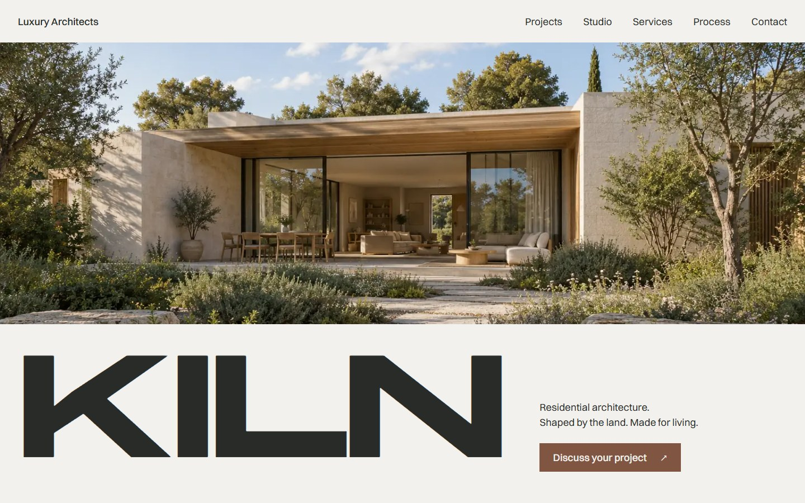
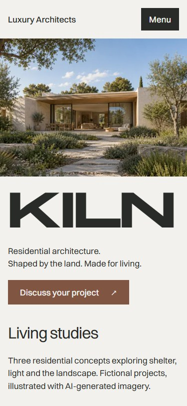
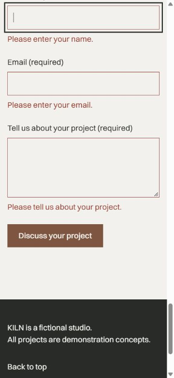
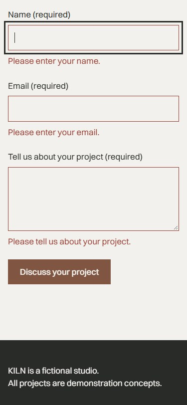

# K13 — поправки и финален polish с Impeccable

[SIN-44](https://linear.app/singularity-lab/issue/SIN-44/k13-popravki-i-polish-s-impeccable), 20 октомври 2026 г. Основа: `2193fdba6d28104189490395276bfab11c7e0ea2`, включва потвърдения merge на [SIN-43 / PR #13](https://github.com/danstoyanov/kiln-luxury-architects/pull/13). Клон: `codex/sin-44-impeccable-polish`, отделно управлявано worktree.

**Резултат:** двете приети находки от [K12](../k12/README.md) са поправени и проверени; допълнително е поправено преливане при увеличено потребителско spacing. Няма нерешена приета P0/P1 находка. Нормалният изглед запазва приетите композиция, палитра, шрифтове, изображения и текстове. PR очаква човешко ревю и merge; няма деплой или работа по K14.

## Финален нормален изглед

Това са снимки от текущия production export, при стандартен размер на текста. Историческите снимки и техническите stress-test кадри са в отделните раздели по-долу.

| Desktop — 1440×900 | Phone — 375×812 |
| --- | --- |
|  |  |

Пълни страници: [1440](final/visual/1440-page.jpg), [768](final/visual/768-page.jpg), [375](final/visual/375-page.jpg). Tablet: [първи екран](final/visual/768-fold.jpg). Projects: [desktop](final/visual/1440-projects.jpg), [tablet](final/visual/768-projects.jpg), [phone](final/visual/375-projects.jpg).

Визуалният polish запазва контраста на минералната/графитна система, редакционната стена и отделните роли на Studio, Services и Process. Проверени са цялата страница и първият екран на трите ширини. Не е установена нужда от нови декоративни ефекти, съдържание или промяна на идентичността. F-02 е конкретното подобрение на визуалния контекст при взаимодействие.

## Резултат за всяка находка

| Находка | Промяна | Проверка и резултат |
| --- | --- | --- |
| **F-01 / P1 — home label/name** | В `Navigation.tsx` accessible name е `Luxury Architects — KILN home`. Видимият текст и `#main` са запазени. | **Поправена.** DOM и Chrome accessibility tree съдържат целия видим надпис; реални Tab/Enter дават 3px фокус и преместват фокуса към main. Проверено при 375/768/1440, плюс намалена височина. |
| **F-02 / P2 — скрит етикет при фокус към грешка** | След render: `focus({ preventScroll: true })`, след това instant scroll към целия field wrapper, `block: nearest` и `scroll-margin-block: 1rem`. | **Поправена.** Празна форма → Name; валидно Name и невалиден Email → Email; валидни Name/Email и празно Message → Message. И трите групи label/control/error са видими, с фокус и готови ARIA описания. Проверено на трите ширини при normal/reduced motion и 375×420. |
| **F-03 / P2 — нова K13 находка: spacing overflow** | Премахнат принудителен nowrap на hero/footer KILN; съществуващият `overflow-wrap: anywhere` позволява reflow. Уточнено е в `DESIGN.md`. | **Поправена.** Преди: 409px document width при viewport 375px с 200% root текст и увеличено spacing. След: document width съвпада с viewport на 375/768/1440; няма установени хоризонтално отрязани текстови контроли. Стандартният едноредов знак остава. |

[Целеви DOM/AX и геометрични измервания](final/fixes/fix-checks.json). Снимките на грешки са заснети **без допълнително превъртане след submit**, за да не прикриват F-02. Има 24 проверки на error група: 3 полета × 4 viewport размера × normal/reduced motion. При първата проверка всички полета са празни; при следващите първото невалидно поле е съответно Email и Message. Фокусът не се задържа в trap.

### F-02 — преди и след

| K12 — етикетът е над екрана | K13 — етикет, поле и грешка са видими |
| --- | --- |
|  |  |

Снимки след focus recovery: [Email](final/fixes/375x812-reduce-email-error.jpg), [Message](final/fixes/375x812-reduce-message-error.jpg), [намален viewport](final/fixes/375x420-reduce-message-error.jpg). `nearest` пази минималното нужно превъртане; разположението може да е към горния или долния край според предишната позиция. Геометрията потвърждава видимостта и на двата режима.

## Изпълнени проверки

Всички браузърни проверки обслужват **самия `out/` през static server на порт 4240**, без `next dev`. Използван е локален Chrome/Edge през фиксирания CDP помощник, отделен временен профил за проверките. Примерните данни са синтетични.

| Проверка | Резултат / доказателство |
| --- | --- |
| `npm ci` | Успешна локална инсталация; lockfile е непроменен. |
| `npm run typecheck` | PASS — Next typegen и TypeScript strict. |
| `npm run lint` | PASS — ESLint без предупреждения. |
| `npm run build` | PASS — static export с `out/index.html`. |
| `node scripts/check-k13.mjs http://localhost:4240 --out docs/k13/final/fixes` | PASS — F-01/F-02, нормално и reduced motion, намалена височина, увеличен текст/spacing. [JSON](final/fixes/fix-checks.json). |
| `node scripts/check-k11.mjs http://localhost:4240 --out docs/k13/final/interactions` | PASS — меню, Escape/Tab/Shift+Tab, anchors, фокус на 899/900px, form validation/correction/reset, точен demo статус. [JSON](final/interactions/interaction-checks.json). |
| Runtime privacy | **0 заявки по време на формата; 0 опита за запис** в Storage/cookies/IndexedDB. Празни local/session storage, cookies и database списък; URL остава същият. [Измервания](final/interactions/interaction-checks.json). Source review също не открива logging/analytics/send операции. |
| Reduced motion | Live media emulation: `scroll-behavior: auto`, без animation/transform/transition, включително превключване по време на сесията. F-02 не анимира scroll и при normal motion. |
| `node scripts/check-k09.mjs http://localhost:4240 --out docs/k13/final/visual` | PASS — 32 файла през HTTP с SHA-256/bytes, responsive WebP/JPEG, DPR 1/2, alt/loading/размери; рамките остават еднакви при задържани image responses. [JSON](final/visual/image-checks.json). |
| Layout shift | Наблюдаваният сбор е под 0.00001 в локалните image проверки; рамките преди/след зареждане съвпадат. Това не е полеви Web Vitals резултат. |
| Console и ресурси | Няма наблюдавани console warning/error, runtime exception или HTTP resource error в проверките. |
| Impeccable | `context --target app/page.tsx`, harden/polish playbooks, craft floor и един `detect --json` върху четирите променени UI файла. [Detector: 0 findings](detector.json). Няма активен hook; няма detector false positives. Няма намерен приложим локален critique-storage backlog; използван е commit-натият доклад K12. |
| Production dependency audit | `npm audit --omit=dev --json`: **0 уязвимости**. [Отчет](production-audit.json). |

Контрастът, семантиката h1/h2/h3 и четирите concept alt текста са прегледани спрямо текущите tokens/source и render. Палитрата е непроменена от [измерените K12 двойки](../k12/technical/contrast.json): graphite/background 12.67:1, graphite/limestone 10.86:1, CTA 5.64:1. В K13 не е заявен нов пълен автоматизиран accessibility audit.

Трите финални browser runs имат еднакви source/export SHA-256 в техните `run.json`: [fixes](final/fixes/run.json), [interactions](final/interactions/run.json), [visual](final/visual/run.json). `sourceCommit` е началният main commit и `workingTreeDirty: true`, защото проверките са преди commit на поправките. `sourceSha256` идентифицира проверените app/components/public/scripts и конфигурация; докладът не представя началния commit като финален source. След тестовете са добавени само документация и доказателства.

## Сравнение с първата версия — исторически K04 → финален K13

**Лявата колона по-долу е стара снимка за сравнение, не върнат дизайн.** K13 не изпълнява стария source и не връща временни изображения.

| Размер | K04 — първа версия | K13 — текущ финал |
| --- | --- | --- |
| 1440 | [Първи екран](../k04/1440-fold.jpg), [цяла страница](../k04/1440-page.jpg) | [Първи екран](final/visual/1440-fold.jpg), [цяла страница](final/visual/1440-page.jpg) |
| 768 | [Първи екран](../k04/768-fold.jpg), [цяла страница](../k04/768-page.jpg) | [Първи екран](final/visual/768-fold.jpg), [цяла страница](final/visual/768-page.jpg) |
| 375 | [Първи екран](../k04/375-fold.jpg), [цяла страница](../k04/375-page.jpg) | [Първи екран](final/visual/375-fold.jpg), [цяла страница](final/visual/375-page.jpg) |

K04 има широк доминиращ знак, временни външни изображения и по-слабо разграничена визуална система. Финалът съчетава KILN и CTA в общ desktop band, по-голяма архитектура, обща серия от четири ImageGen кадъра, 3:2 редакционна проектна стена, уточнени типографски роли и секционен ритъм. Tablet/phone преминават в четим последователен ред. Това са натрупани промени K05–K13; K13 самостоятелно добавя конкретните достъпност/reflow поправки, не си приписва цялата трансформация.

## Технически stress-test кадри — различни от нормалния дизайн

Тестът увеличава root font-size до 200% и едновременно задава line-height 1.5, letter-spacing .12em, word-spacing .16em и paragraph spacing 2em. Той проверява reflow, не предлага нова типография. Разпокъсаното KILN в тези кадри е очакван резултат от потребителските настройки.

[375 hero reflow](final/fixes/375-name-200-spacing.jpg) · [375 footer reflow](final/fixes/375-footer-200-spacing.jpg) · [375 contact](final/fixes/375-text-200-spacing.jpg) · [768](final/fixes/768-text-200-spacing.jpg) · [1440](final/fixes/1440-text-200-spacing.jpg). [Предишен stress-test кадър с преливане](before/375-spacing-before.jpg).

## Ограничения и предаване

- 375×420 е намален viewport с реални синтетични клавиатурни събития, **не** физически телефон със системна екранна клавиатура. Промяна само на visual viewport при реална mobile клавиатура не е измерена; F-02 не е обявена за проверена на всички мобилни ОС.
- 200% е root text scaling, комбинирано със spacing; не се твърди тест с browser chrome zoom. Основните договорени ширини и 899/900 границата са проверени. Няма нов отделен 320px сценарий в K13.
- Няма реален screen reader/speech control, Safari/Firefox, Lighthouse, throttled Web Vitals/INP или hosted-site проверка. DOM/AX и keyboard проверки не са пълна WCAG сертификация.
- ESLint остава с известното предупреждение за неподдържана 9.x версия. Пълният `npm audit` повторно отчита 5 high записа по една **development** верига `eslint-config-next → @next/eslint-plugin-next → fast-glob → micromatch → braces`; това е вече документираното K02 ограничение. Те не влизат в статичния export; production audit е чист. Няма принудителен downgrade или промяна на зависимостите.
- Native ImageGen masters остават 1536px; няма нови изображения или изкуствено увеличаване на детайл.
- Worktree-то и PR се пазят за човешко ревю. SIN-44 остава **In Review**, чатът — **🔴 SIN-44**, докато потребителят не направи merge и критериите не бъдат приети. Няма автоматично сливане, публикуване или започване на следващата задача.

## Повторение

От своето worktree: `npm ci`, `npm run typecheck`, `npm run lint`, `npm run build`. В отделен терминал: `npm exec -- serve out --listen 4240 --no-clipboard`. После трите browser команди от таблицата, с нови `--out` директории, за да се запазят историческите доказателства. Нужни са Node 22 и локален Chrome/Edge. Подробните команди са и в [README](../../README.md#k13--поправки-и-финален-polish).
