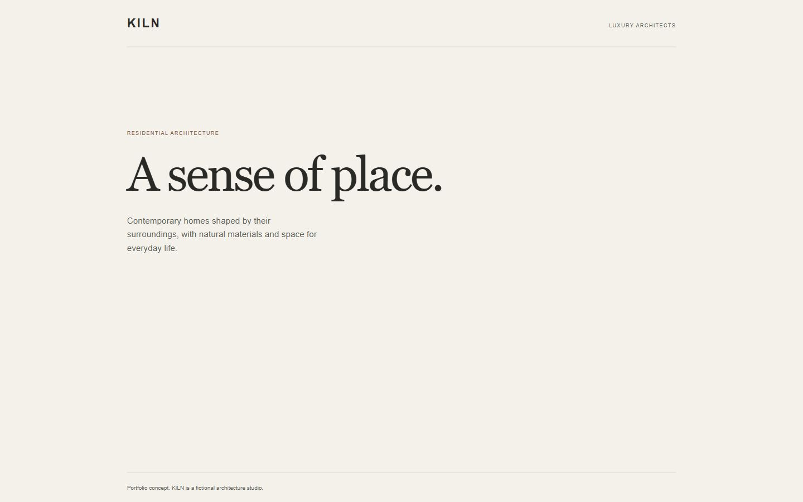

# SIN-33 — Next.js foundation verification

Verified on 20 October 2026, Windows, Node 22.21.0 and npm 10.9.4.

Base: origin/main at 4f6997dd4ee4c55420d52182b448b2ead42fdd08.
SIN-32 PR #1 was confirmed merged before this branch was created.

## Checks

- npm ci: passed using the committed lockfile.
- npm run typecheck: passed, including route type generation before tsc.
- npm run lint: passed with zero warnings.
- npm run build: passed; out/index.html exists and / is prerendered.
- npm run dev -- --port 3001: returned HTTP 200 and opened in the browser.
- npm run preview: served the generated out/ on localhost:4173.
- Static HTML and every linked /_next/ CSS and JavaScript resource: HTTP 200.
- Browser console for the static export: no errors or warnings.
- Effective CSS viewports 375 × 812, 768 × 1024 and 1440 × 900:
  readable content, correct wrapping, no horizontal overflow.
- git diff --check: passed.

The browser host used 130% scaling. Viewport inputs were adjusted and the
effective CSS widths were verified through window.innerWidth and
document.documentElement.scrollWidth.

## Scope and limitations

This is the minimal K02 foundation. Full page sections, navigation, the demo
form, architectural images and the final design belong to later tasks.
No deployment was performed.

npm audit --omit=dev reports zero vulnerabilities. Full npm audit reports
five high entries in one development-only chain ending in braces 3.0.3,
with no patched release available. ESLint 9 is deprecated but remains the
version supported by the React plugin in the Next.js preset.
README documents both limitations and the compression 1.8.2 override.

## Static export screenshots

Desktop, 1440 × 900:

Mobile, 375 × 812:

